# Projet Leyenda

Chaîne de traitement d'images numérisées pour TouNum, en TensorFlow / Keras, et un site web local pour la tester
dans le navigateur.

```
 images numérisées ──► [ L2 : débruitage ] ──► [ L1 : photo, peinture ou autre ? ] ──► [ L3 : captioning ]
                        toutes les images         on ne garde que les photos              (à venir)
```

D'après l'étude du livrable 2, le débruitage doit passer **avant** la classification : le classifieur du livrable 1
ne reconnaît plus les photos quand elles sont bruitées (voir [Ordre de la pipeline](#ordre-de-la-pipeline--débruiter-avant-de-classer)).

**Groupe** : Isrâ Boudemagh · Théophile Noel · Bruno Rieckenberg · Corentin Romano

## Organisation

```
projet/
├── Livrable1/            classification (notebooks L1 et L1,1, rendu)
│   └── dataset/          un sous-dossier par classe (non versionné)
├── Livrable2/            débruitage (notebook L2)
│   ├── dataset/          images du livrable 2 (non versionné)
│   ├── images_bruitees/  trois images réellement bruitées, pour l'essai final du notebook
│   └── sorties/          images produites par les démonstrations du notebook (non versionné)
├── models/               TOUS les modèles entraînés (.keras, non versionnés) et leurs historiques (.csv)
├── Test_photos/          12 images de test choisies à la main, jamais vues à l'entraînement
├── Test_website/         site de test (index.html) et modèles exportés pour le navigateur
│   ├── catalogue.json    modèles de models/ affichés par le site
│   ├── convertir_modeles.py / .bat
│   ├── js/               code du site (un fichier par onglet) et TensorFlow.js
│   └── modeles/          exports générés : L1_classification/, L2_debruitage/
├── docs/                 figures de ce README
└── requirements.txt
```

## Lancer chaque livrable indépendamment

Chaque livrable est un notebook autonome, lancé depuis son propre dossier : il lit son dataset, entraîne son
réseau, **enregistre le modèle dans `models/` dès la fin de l'entraînement**, puis l'évalue. Ce qui vient après
(étude de cas du livrable 2, site de test, pipeline) ne relance jamais un entraînement : tout recharge les
modèles enregistrés.

| Livrable | Notebook | Données | Modèles enregistrés dans `models/` |
|---|---|---|---|
| L1 classification, 2 classes | `Livrable1/L1.ipynb` | `Livrable1/dataset/<Classe>/` | `lucky_model2.keras` |
| L1 classification, 3 classes | `Livrable1/L1,1.ipynb` | `Livrable1/dataset/<Classe>/` | `lucky_model1.1.keras` |
| L2 débruitage | `Livrable2/L2.ipynb` | `Livrable2/dataset/` | `cae_saut_v2.keras` (+ `_historique.csv`) |

```bash
pip install -r requirements.txt
jupyter lab                    # ouvrir le notebook voulu
```

Dans `L2.ipynb`, `L2_RETRAIN=0` recharge le modèle déjà enregistré au lieu de ré-entraîner, et la dernière
cellule de la partie 12 publie le modèle sur le site (voir plus bas). L'entraînement complet est fait pour une
carte graphique (14,5 minutes avec WSL + TensorFlow GPU) ; sur processeur seul, réduire `L2_EPOCHS` ou `L2_PAS`.

## Livrable 1 : classification

### Modèles retenus

On garde le meilleur modèle de chaque notebook. Ce sont les deux classifieurs testables sur le site.

| Fichier | Notebook | Classes | Accuracy test | Nom sur le site |
|---|---|---|---|---|
| `lucky_model2.keras` | `Livrable1/L1.ipynb` | Others / Photo | 94,3 % | `model_photo_autre` |
| `lucky_model1.1.keras` | `Livrable1/L1,1.ipynb` | Others / Painting / Photo | 92,0 % | `model_photo_autre_peinture` |

Les autres essais restent dans les notebooks pour comparaison (par exemple le modèle *P2P* peinture / photo de
`L1,1.ipynb`), mais ils ne sont pas retenus.

### Données

* 41 399 images, un dossier par classe (le nom du dossier sert d'étiquette).
* Nettoyage des images illisibles, puis découpage **80 % entraînement / 20 % test** (`seed=42`).
* Images redimensionnées en **200×200**, batchs de **128**.
* **Augmentation** : miroir horizontal, rotation ± 36°, zoom ± 20 % (pas de changement de couleur, la couleur
  aide à reconnaître une peinture).

### Architecture

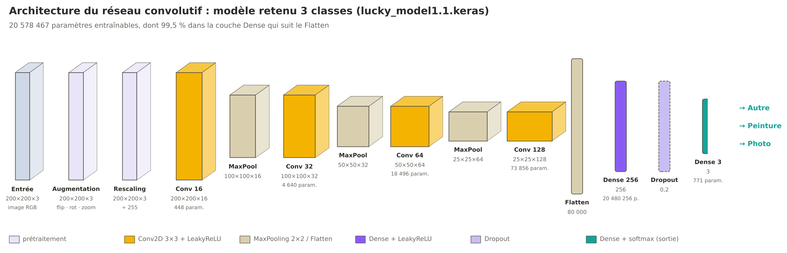

* 4 blocs **Conv2D 3×3** (16, 32, 64, 128 filtres, `padding='same'`, **LeakyReLU**) séparés par du **MaxPooling 2×2**.
* **Flatten**, **Dense(256)** + LeakyReLU, **Dropout(0,2)**, puis **Dense + softmax** (une probabilité par classe).
* 20,6 millions de paramètres, dont 99,5 % dans la couche Dense après le Flatten.
* `lucky_model2.keras` est une version plus légère : 3 blocs convolutifs, Dense(128), 2 sorties.

### Entraînement

* **Perte** : entropie croisée catégorielle (`SparseCategoricalCrossentropy`), soit −log de la probabilité donnée à
  la bonne classe. Elle punit fortement les erreurs commises avec assurance.
* **Optimiseur** : **Adam**, pas initial 10⁻³. Il combine un momentum (moyenne des gradients) et un pas propre à
  chaque poids (moyenne des gradients au carré). Ce n'est pas un SVM : un SVM est un autre type de classifieur, pas
  un optimiseur.
* **Callbacks** : `ReduceLROnPlateau` (pas × 0,75 dès que la perte de test stagne, minimum 10⁻⁵) et
  `EarlyStopping` (patience 15, retour aux meilleurs poids).

### Résultats

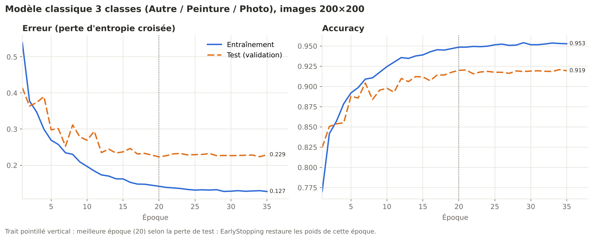

Modèle 3 classes : meilleure époque 20, accuracy **94,9 %** à l'entraînement et **92,0 %** au test.

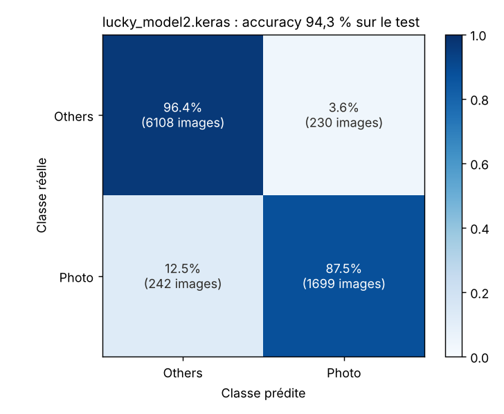

Modèle 2 classes : 94,3 % au test, mais 87,5 % seulement des photos reconnues, car elles ne représentent que 23 %
des images.

### Biais / variance

* **Variance modérée** : environ 3 points d'écart entre entraînement et test, puis la perte de test stagne alors
  que celle d'entraînement baisse encore. Le sur-apprentissage est contenu par l'augmentation, le dropout, la baisse
  du pas et l'early stopping.
* **Biais présent** : même à l'entraînement le réseau plafonne vers 95 % (réseau convolutif peu profond, images
  200×200, images ambiguës).
* **Limite** : le jeu de test sert aussi à choisir l'époque d'arrêt, les scores sont donc un peu optimistes.

### Pistes d'amélioration

* Remplacer `Flatten` par `GlobalAveragePooling2D` : la couche dense passerait de 20,5 M à 33 000 paramètres.
* Plus de régularisation : dropout 0,4-0,5, régularisation L2, augmentation plus variée.
* Batch Normalization, réseau plus profond ou transfer learning (MobileNet, EfficientNet) pour réduire le biais.
* Rééquilibrer les classes (`class_weight`) et garder un vrai jeu de test séparé (70 / 15 / 15).
* Ajouter du bruit à l'augmentation : le classifieur n'en a jamais vu, et il rejette les photos bruitées (voir le
  livrable 2).

## Livrable 2 : débruitage

Un **réseau convolutif de débruitage** reçoit une photo bruitée RGB et rend la même photo, débruitée et de même
taille. Il est entraîné de zéro avec TensorFlow / Keras, sans réseau pré-entraîné (pas de transfer learning). Le
détail (bruits, mesures, filtres classiques, architecture, perte, Adam, biais / variance, études de cas) est dans
`Livrable2/L2.ipynb`. Le modèle retenu est `models/cae_saut_v2.keras`.

### Démarche

1. **Mesurer avant de débruiter.** Deux mesures comparent l'image débruitée à l'image propre : le **PSNR** (en dB,
   directement lié à l'erreur quadratique moyenne, +3 dB = erreur divisée par 2) et le **SSIM** (ressemblance des
   structures, de 0 à 1). Point de comparaison : les filtres classiques (gaussien, médian), avec leur meilleur
   réglage choisi en regardant l'image propre, ce qui les avantage.
2. **Version 1** (`cae_saut`) : un auto-encodeur convolutif à connexions de saut, entraîné sur les images entières
   réduites en 200×200, avec du bruit gaussien seul. Il battait les filtres classiques, mais de peu (environ +1 dB).
3. **Diagnostic** : la version 1 était limitée par son **biais** (erreur d'entraînement aussi haute que celle du
   test), pas par sa variance. Les causes, et ce que la version 2 change :

| Limite de la version 1 | Correction dans la version 2 |
|---|---|
| **Très peu d'entraînement** : 118 images, soit 4 mises à jour des poids par époque, environ 180 au total | des **patchs** (morceaux d'image) tirés au hasard à l'infini : 250 mises à jour par époque, **20 000** au total |
| Entraînée sur des images **réduites en 200×200**, utilisée sur des photos **en pleine résolution** (site, workflow) : le grain n'a pas la même échelle | patchs découpés **en pleine résolution**, après une réduction aléatoire d'un facteur 0,5 à 1 |
| Seulement du **bruit gaussien** : le poivre et sel et le bruit multiplicatif d'un vrai scan étaient mal traités | **bruit mixte** (gaussien, speckle, poivre et sel), tiré au hasard pour chaque patch |
| Goulot étroit (64 filtres) au fond du réseau, qui écrase les détails | fond du U à **256 filtres** (deux convolutions) |
| Augmentation réduite au miroir | miroirs **et** rotations d'un quart de tour |

Le squelette du réseau ne change presque pas (voir les deux schémas plus bas) : l'essentiel du gain vient de la
façon d'entraîner, pas d'un réseau plus gros.

### Données et bruit

* **148 images**, découpées 80 / 20 : 118 pour l'entraînement, 30 pour le test (`seed=42`, comme le livrable 1).
* **Entraînement** : patchs de **128×128** tirés au hasard dans les images d'origine (réduites d'un facteur 0,5 à 1),
  miroirs et rotations de 90°, batchs de 16. Chaque image fournit ainsi des centaines d'exemples différents.
* **Bruit mixte**, tiré à neuf pour chaque patch :

| Bruit | Probabilité | Intensité | Ce qu'il imite |
|---|---|---|---|
| Gaussien additif | 50 % | σ entre 0 et 0,30 (pixels entre 0 et 1) | grain du capteur ou du scanner |
| Speckle (multiplicatif) | 25 % | σ entre 0,05 et 0,30 | bruit plus fort sur les zones claires |
| Poivre et sel | 25 % | 1 à 10 % des pixels, plus un léger bruit gaussien | poussières, pixels morts |

* **Test** : les 30 images de test, recadrées en **256×256 au centre, en pleine résolution**, avec un bruit gaussien
  fixe et reproductible de **σ = 0,15**. Les mêmes mesures sont refaites sur le protocole de la version 1 (images
  réduites en 200×200) pour comparer honnêtement.

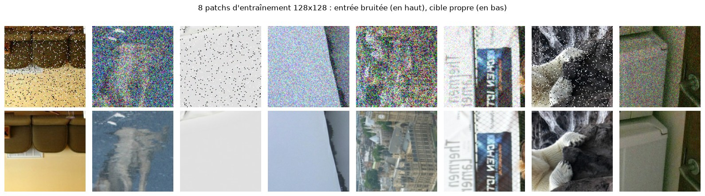

### Architecture

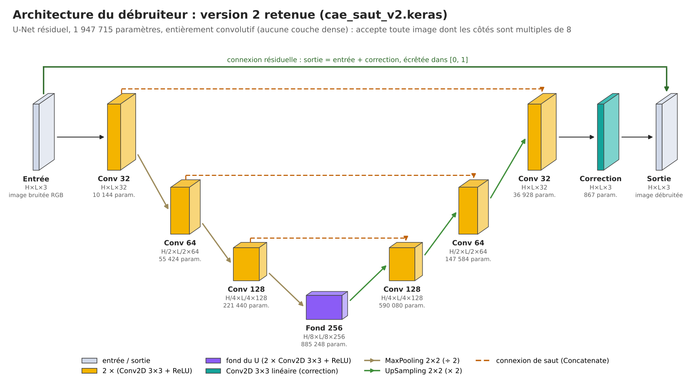

* **U-Net résiduel** à 3 niveaux : à chaque niveau, deux convolutions 3×3 + ReLU (`padding='same'`), puis un
  MaxPooling 2×2 qui divise la taille par 2 ; le fond travaille à 1/8 de la résolution avec 256 filtres ; la remontée
  utilise UpSampling 2×2.
* **Connexions de saut** (Concatenate) : à chaque niveau, la sortie de l'encodeur est recollée à l'entrée du
  décodeur. Les détails fins, perdus en descendant, reviennent directement : le réseau n'a pas à les reconstruire.
* **Apprentissage résiduel** : la dernière convolution (linéaire, 3 filtres) prédit une **correction** que l'on
  ajoute à l'image d'entrée, puis le résultat est écrêté dans [0, 1] (`ReLU(max_value=1)`). Le réseau apprend
  seulement le bruit à retirer, ce qui est plus simple que de redessiner toute l'image.
* **Entièrement convolutif** (ni `Flatten` ni `Dense`) : 1 947 715 paramètres, et il accepte des images de toute
  taille, multiple de 8 (trois MaxPooling). C'est ce qui permet de débruiter des photos entières sur le site.
* **Pas de Batch Normalization** : essayée, elle rendait le PSNR de test instable d'une époque à l'autre avec le
  bruit mixte (les statistiques mémorisées à l'entraînement ne correspondent pas aux images de test), jusqu'à
  passer sous celui de l'image bruitée. Les réseaux récents de restauration d'image s'en passent pour la même
  raison.

Pour comparaison, la version 1 a le même squelette ; seul son fond est un goulot d'une convolution de 64 filtres :

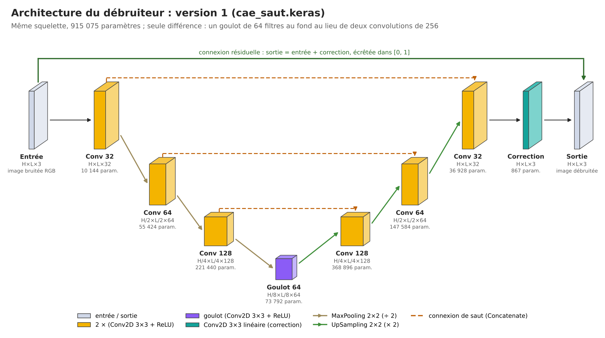

### Entraînement

* **Perte** : erreur quadratique moyenne (MSE), qui est exactement ce que mesure le PSNR.
* **Optimiseur** : **Adam**, pas initial 10⁻³ (même choix que le livrable 1).
* **Époques** : 250 mises à jour des poids par époque, 80 époques au plus.
* **Callbacks** : `ReduceLROnPlateau` (pas × 0,5 après 4 époques sans progrès, minimum 10⁻⁵) et `EarlyStopping`
  (patience 12, retour aux meilleurs poids).
* **Durée** : **14,5 minutes** sur carte graphique (WSL + TensorFlow GPU).

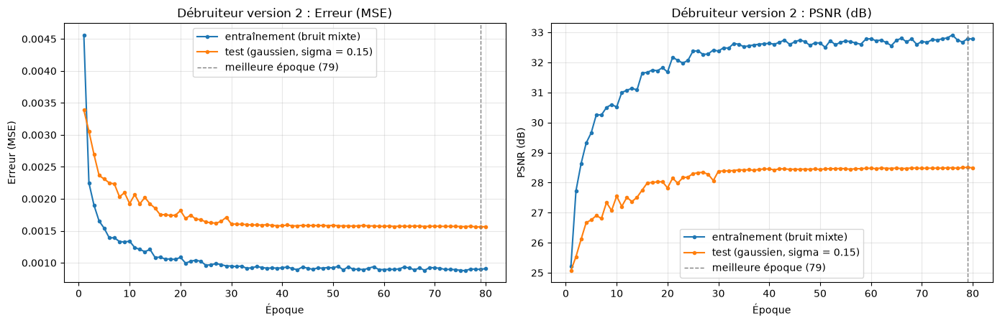

Le PSNR de test monte vite pendant une vingtaine d'époques puis se stabilise vers **28,5 dB**, pendant que le pas
d'apprentissage est divisé par 2 à chaque palier (de l'époque 15 à l'époque 42, où il atteint le minimum 10⁻⁵).
La meilleure époque est la 79e et l'early stopping ne s'est pas déclenché, mais les 40 dernières époques
n'apportent presque rien (+0,05 dB) : une cinquantaine d'époques suffirait. La courbe d'entraînement est plus haute que
celle du test sans que ce soit du sur-apprentissage : elle est mesurée sur le bruit mixte, souvent plus léger
(σ tiré entre 0 et 0,30, poivre et sel facile à repérer) que le test à σ = 0,15. La comparaison à protocole
identique, plus bas, le confirme.

### Résultats

**30 images de test, bruit gaussien σ = 0,15** :

| Méthode | PSNR pleine résolution | SSIM | PSNR 200×200 (protocole v1) | SSIM |
|---|---|---|---|---|
| Image bruitée, sans traitement | 17,15 dB | 0,254 | 17,17 dB | 0,303 |
| Filtre gaussien (meilleur réglage) | 23,99 dB | 0,563 | 23,31 dB | 0,584 |
| Filtre médian (meilleur réglage) | 23,25 dB | 0,511 | 22,38 dB | 0,519 |
| Version 1, `cae_saut` | 24,99 dB | 0,603 | 24,48 dB | 0,633 |
| **Version 2, `cae_saut_v2`** | **28,50 dB** | **0,793** | **27,32 dB** | **0,804** |

En pleine résolution, la version 2 gagne **+11,4 dB** sur l'image bruitée, **+4,5 dB** sur le meilleur filtre
classique et **+3,5 dB** sur la version 1 (SSIM +0,19). Elle reste la meilleure sur le protocole de la version 1.

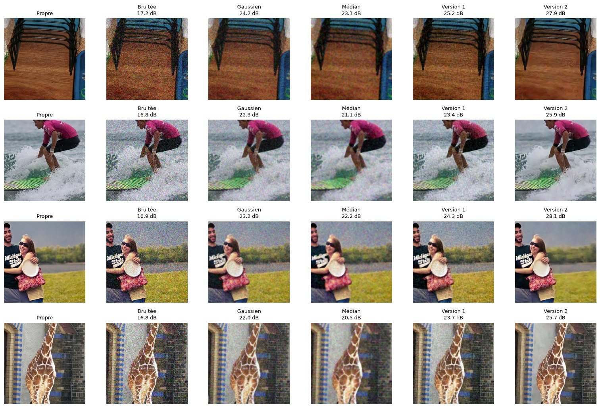

Le filtre gaussien floute tout, le médian laisse des taches, la version 1 laisse du grain coloré ; la version 2
rend des surfaces propres en gardant les contours.

**Selon le niveau de bruit** (σ de 0,05 à 0,40) :

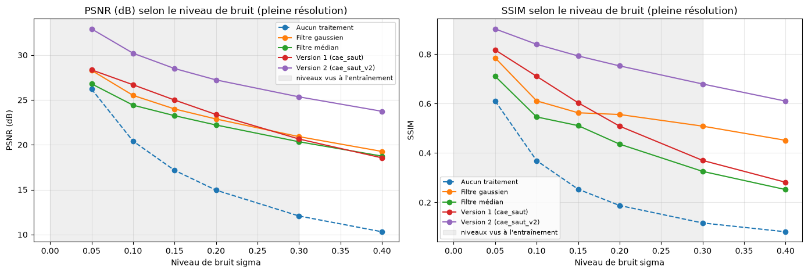

La version 2 est la meilleure méthode à tous les niveaux, y compris à σ = 0,40, plus fort que tout ce qu'elle a vu
à l'entraînement : 23,73 dB, contre 19,26 dB pour le filtre gaussien et 18,54 dB pour la version 1.

**Selon le type de bruit** (PSNR, mêmes images de test) :

| Bruit | Sans traitement | Filtre gaussien | Filtre médian | Version 1 | **Version 2** |
|---|---|---|---|---|---|
| Gaussien, σ = 0,15 | 17,16 dB | 23,99 dB | 23,23 dB | 24,98 dB | **28,51 dB** |
| Speckle (multiplicatif) | 21,16 dB | 25,80 dB | 24,73 dB | 26,89 dB | **30,91 dB** |
| Poivre et sel, 5 % | 17,88 dB | 24,41 dB | 28,06 dB | 23,07 dB | **35,38 dB** |
| Flou + léger bruit | 24,05 dB | 24,75 dB | 24,75 dB | 24,59 dB | **25,15 dB** |

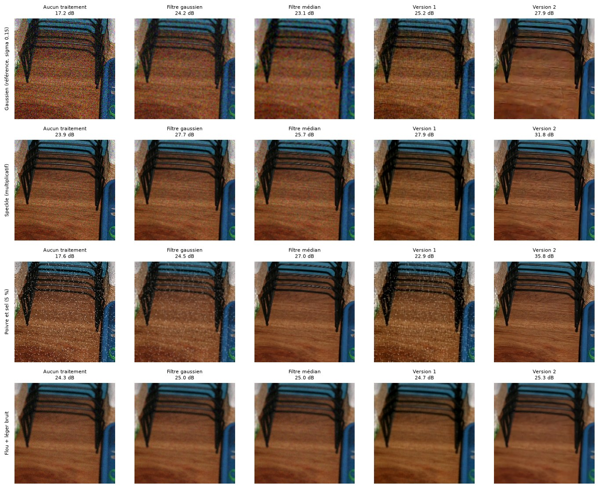

Le bruit mixte a payé : sur le poivre et sel, la version 1 faisait moins bien que le filtre médian, la version 2 le
dépasse de 7,3 dB. Le flou, lui, n'est presque pas corrigé (+1,1 dB) : ce n'est pas du bruit, et le réseau n'a pas
été entraîné à le retirer.

**Sur les 12 images de `Test_photos/`** (jamais vues, pleine taille, σ = 0,15), le gain moyen est de **+10,4 dB**
(de +4,7 à +15,4 dB selon l'image).

### Biais / variance

Même protocole pour l'entraînement (118 images) et le test (30 images) : carrés 256×256 en pleine résolution,
σ = 0,15.

| Modèle | MSE entraînement | MSE test | Écart | PSNR entraînement | PSNR test |
|---|---|---|---|---|---|
| Version 1 | 0,00362 | 0,00329 | −9 % | 24,69 dB | 24,98 dB |
| **Version 2** | **0,00180** | **0,00156** | −13 % | **28,12 dB** | **28,51 dB** |

* **Variance faible** pour les deux : l'erreur de test n'est pas plus haute que celle d'entraînement, le réseau
  généralise à des images qu'il n'a jamais vues (les images de test sont même un peu plus faciles).
* **Biais nettement réduit** : l'erreur d'entraînement de la version 2 est **deux fois plus basse** que celle de la
  version 1. C'était bien le biais qui limitait la version 1, et ce sont les corrections de la démarche (beaucoup plus
  de mises à jour, pleine résolution, fond plus large) qui l'ont réduit.

### Limites

* **Le vrai bruit n'est pas le bruit simulé.** Sur l'image réellement bruitée
  `Livrable2/images_bruitees/Noise_salt_and_pepper.png`, la version 2 enlève peu de chose : ses points parasites
  sont gris clair, pas blancs ou noirs purs (l'image a été retouchée ou compressée), alors que le poivre et sel
  simulé met les pixels exactement à 0 ou à 1. Le réseau ne les reconnaît donc pas comme du bruit.
* **Textures fines lissées** : la perte MSE pousse vers une moyenne, donc un grain de bois ou un feuillage très fin
  ressort un peu lissé (zoom dans la partie 9 du notebook).
* Les 30 images de test servent aussi à surveiller l'entraînement (baisse du pas, early stopping) : les scores sont
  un peu optimistes ; un jeu de validation séparé serait plus rigoureux.

**Pistes** : ajouter des bruits plus réalistes (compression JPEG, bruit de Poisson, points parasites d'intensité
variable, bandes de scanner) ; une perte qui mélange MSE et SSIM pour mieux garder les textures ; plus d'images ; dans le notebook,
débruiter les très grandes images par tuiles comme le fait le site, pour limiter la mémoire de la carte graphique.

### Ordre de la pipeline : débruiter avant de classer

En reliant les deux livrables, on a détecté un problème : **le classifieur du livrable 1 ne reconnaît plus les
photos dès qu'elles sont bruitées**. La partie 10 du notebook donne les 30 photos de test au classifieur
`lucky_model2.keras`, propres, bruitées, puis débruitées :

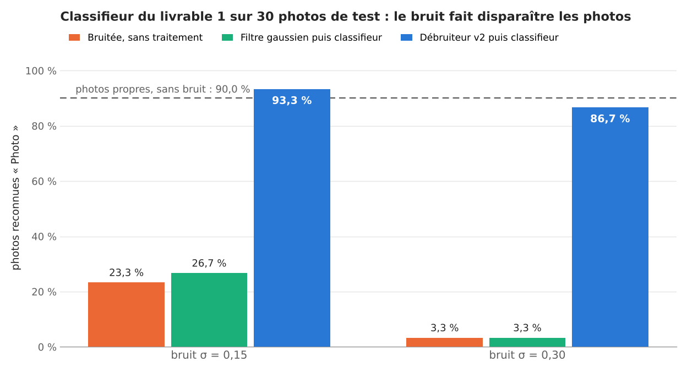

| Images données au classifieur | Bruit | Photos reconnues « Photo » | Probabilité moyenne de « Photo » |
|---|---|---|---|
| Propres (référence) | aucun | 90,0 % | 0,85 |
| Bruitées, sans traitement | σ = 0,15 | 23,3 % | 0,23 |
| Filtre gaussien, puis classifieur | σ = 0,15 | 26,7 % | 0,31 |
| **Débruiteur v2, puis classifieur** | σ = 0,15 | **93,3 %** | **0,88** |
| Bruitées, sans traitement | σ = 0,30 | 3,3 % | 0,05 |
| Filtre gaussien, puis classifieur | σ = 0,30 | 3,3 % | 0,10 |
| **Débruiteur v2, puis classifieur** | σ = 0,30 | **86,7 %** | **0,81** |

**Pourquoi c'est un problème.** Dans l'ordre actuel (L1 puis L2), seules les images classées « Photo » passent au
débruitage. Or ce sont justement les photos bruitées que le classifieur rejette : avec un bruit de σ = 0,15, 3 photos
sur 4 sont écartées comme « Autre » **avant** d'atteindre le débruiteur. La démonstration de la partie 12 le
confirme : sur un lot de 15 images bruitées, **aucune** n'a passé le classifieur, y compris `photo1` à `photo4`
(probabilité de « Photo » entre 0,002 et 0,26). Le classifieur n'a jamais vu de bruit à l'entraînement (son
augmentation se limite aux miroirs, rotations et zooms) : le grain lui fait prendre une photo pour autre chose.

**Pourquoi débruiter d'abord règle le problème.** Une fois passées par le débruiteur, les photos sont de nouveau
reconnues au niveau des photos propres (93,3 % à σ = 0,15, 86,7 % à σ = 0,30). Un simple filtre gaussien ne suffit
pas (26,7 %) : il faut un débruitage qui garde les contours et les couleurs sur lesquels le classifieur s'appuie.

**Ordre recommandé** :

```
 images numérisées ──► [ L2 : débruitage ] ──► [ L1 : photo, peinture ou autre ? ] ──► [ L3 : captioning ]
                        toutes les images         on ne garde que les photos              (à venir)
```

* **Coût** : toutes les images passent par le débruiteur, pas seulement les photos ; le temps de calcul augmente
  d'autant, ce qui reste acceptable pour un traitement par lots.
* **À vérifier** : l'étude ne porte que sur des photos. Il faut encore mesurer que le débruitage ne fait pas passer des
  peintures ou des images « Autre » pour des photos.
* **Complément possible** : ré-entraîner le classifieur du livrable 1 avec du bruit dans son augmentation, pour
  qu'il soit robuste même sans débruitage.

## Site de test

Ouvrir `Test_website/index.html` (double-clic, aucun serveur ni connexion nécessaires). Tout est calculé dans le
navigateur avec **TensorFlow.js** (copie locale dans `js/lib/`), sur la carte graphique via WebGL quand c'est
possible ; aucune image ne quitte l'ordinateur.

Les grandes images sont débruitées **par tuiles** qui se chevauchent d'au moins le champ réceptif du réseau :
le résultat est identique à celui d'un calcul d'un seul bloc, mais aucun tenseur ne dépasse la taille que la carte
graphique sait adresser exactement (au-delà, certaines cartes donnaient des rayures et une teinte magenta). Au
chargement, chaque modèle est **vérifié** sur un motif de contrôle calculé par Keras lors de la conversion ; si la
carte graphique donne un résultat faux même avec de petites tuiles, le site passe sur le processeur (plus lent mais
exact). Le panneau des modèles affiche le résultat de cette vérification.

Trois onglets :

| Onglet | Ce qu'il fait |
|---|---|
| **L1 Classification** | chaque image passe dans les classifieurs activés : classe prédite, confiance, consensus, « En vrai » pour noter les modèles |
| **L2 Débruitage** | chaque image passe dans les débruiteurs activés ; curseur avant / après, gain de PSNR et SSIM. Par défaut l'image déposée sert de référence propre et le site lui ajoute un bruit gaussien de σ réglable, comme le notebook. En mode « déjà bruitée », pas de référence : seul le bruit estimé avant / après est affiché |
| **Pipeline** | un dossier (sous-dossiers compris) passe par le classifieur choisi, seules les images avec P(Photo) ≥ seuil continuent vers le débruiteur ; l'étape 3 (captioning) est réservée au livrable 3. On récupère les photos débruitées et un rapport CSV dans un .zip. Option « lot bruité simulé » pour mesurer le vrai gain. Cet onglet suit encore l'ordre d'origine (L1 puis L2) : à inverser d'après l'étude du livrable 2 |

### Ajouter ou mettre à jour un modèle

1. L'enregistrer dans `models/` (les notebooks le font en fin d'entraînement).
2. S'il est nouveau, l'ajouter dans `Test_website/catalogue.json`, rubrique `L1_classification` (avec ses classes,
   dans l'ordre alphabétique des dossiers du dataset) ou `L2_debruitage`.
3. Lancer `Test_website/convertir_modeles.bat` (Windows) ou `python convertir_modeles.py` (WSL / Linux), puis
   recharger la page.

Le script n'exporte que les modèles nouveaux ou modifiés et **vérifie chaque export** : il refait le calcul du
réseau avec les poids exportés et le compare à Keras (écart maximal affiché, de l'ordre de 10⁻⁶ pour les
débruiteurs). Les classifieurs (20 M de paramètres) sont stockés en float16, les débruiteurs en float32.
Couches gérées : convolutions, pooling, dense, normalisations, UpSampling2D, Concatenate, Add et les activations
courantes, en modèle séquentiel ou fonctionnel (connexions de saut).
